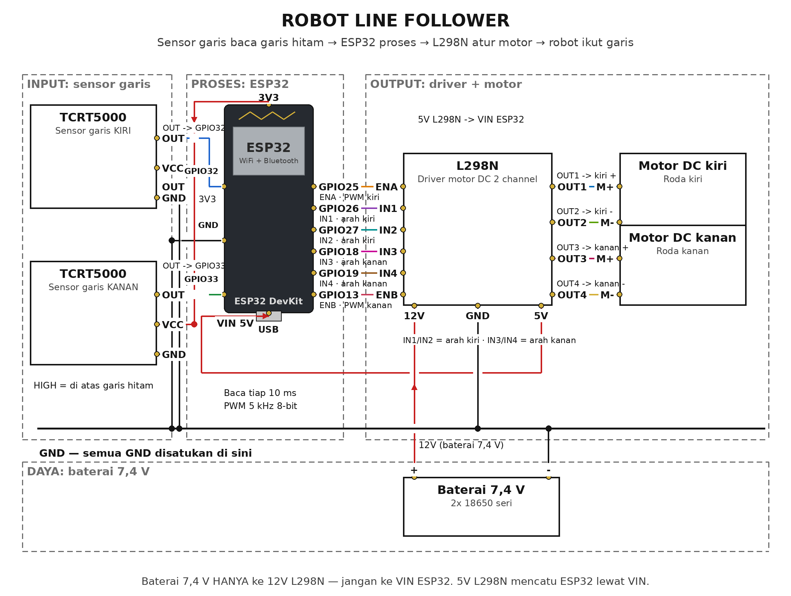

# Robot Line Follower — ESP32 + 2 Sensor Garis TCRT5000 + Driver L298N

Robot yang mengikuti garis hitam di lantai putih secara otomatis, tanpa disentuh sama sekali. Dua sensor garis TCRT5000 menjadi "mata" robot: ESP32 membaca keduanya tiap 10 milidetik, lalu mengatur kecepatan dua motor DC lewat driver L298N dengan PWM. Begitu garis menikung, robot langsung belok sendiri.

Kode dari YouTube Short **"Robotmu Nabrak Tembok Terus? Bikin Dia Ikut Garis Sendiri! | ESP32"** — link menyusul setelah upload.

## Komponen

| Komponen | Keterangan |
|---|---|
| ESP32 DevKit | Board utama |
| Sensor garis TCRT5000 (2x) | "Mata" robot, kiri dan kanan |
| Driver motor L298N | Mengatur arah + kecepatan motor |
| Motor DC 3–6 V (2x) | Roda kiri dan roda kanan |
| Baterai 7,4 V (2x 18650 seri) | Catu motor + ESP32 |
| Chassis robot + 2 roda | Rangka robot |

## Skema rangkaian



## Wiring

| Komponen | Pin ESP32 / L298N |
|---|---|
| Sensor kiri OUT | GPIO32 |
| Sensor kanan OUT | GPIO33 |
| Sensor VCC / GND | 3V3 / GND |
| L298N ENA (PWM motor kiri) | GPIO25 |
| L298N IN1 / IN2 (arah motor kiri) | GPIO26 / GPIO27 |
| L298N IN3 / IN4 (arah motor kanan) | GPIO18 / GPIO19 |
| L298N ENB (PWM motor kanan) | GPIO13 |
| L298N 12V | Baterai 7,4 V (+) |
| L298N 5V | VIN ESP32 |
| L298N GND | GND (disatukan dengan GND ESP32) |
| L298N OUT1 / OUT2 | Motor kiri (+ / −) |
| L298N OUT3 / OUT4 | Motor kanan (+ / −) |
| LED bawaan | GPIO2 (menyala saat robot mengikuti garis) |

> ⚠️ **Penting:** baterai 7,4 V HANYA ke pin 12V L298N — jangan ke VIN ESP32. ESP32 dicatu dari pin 5V L298N lewat VIN.

## Cara kerja

Sensor TCRT5000 mengeluarkan HIGH saat di atas garis hitam, LOW saat di atas lantai putih. Kalau modulmu terbalik (LOW di atas garis), ubah nilai `SENSOR_GARIS_AKTIF` di `RobotLineFollower.ino` menjadi `LOW`.

| Sensor kiri | Sensor kanan | Robot |
|---|---|---|
| Di garis | Di garis | Maju lurus (PWM 180) |
| Di garis | Di luar garis | Belok kiri (kiri 80, kanan 200) |
| Di luar garis | Di garis | Belok kanan (kiri 200, kanan 80) |
| Di luar garis | Di luar garis | Berhenti (garis hilang) |

```cpp
kiriDiGaris  = (digitalRead(PIN_SENSOR_KIRI)  == SENSOR_GARIS_AKTIF);
kananDiGaris = (digitalRead(PIN_SENSOR_KANAN) == SENSOR_GARIS_AKTIF);
if (kiriDiGaris && kananDiGaris)      majuLurus();
else if (kiriDiGaris)                 belokKiri();
else if (kananDiGaris)                belokKanan();
else                                  berhenti();
```

## Konfigurasi

Ubah di atas file `RobotLineFollower/RobotLineFollower.ino`:

| Konstanta | Nilai | Keterangan |
|---|---|---|
| `KECEPATAN_LURUS` | 180 | PWM 0–255 saat maju lurus |
| `KECEPATAN_BELOK_LUAR` | 200 | PWM roda luar saat belok |
| `KECEPATAN_BELOK_DALAM` | 80 | PWM roda dalam saat belok |
| `INTERVAL_BACA_MS` | 10 | Baca sensor tiap 10 ms |
| `FREKUENSI_PWM_HZ` | 5000 | Frekuensi PWM motor |
| `RESOLUSI_PWM_BIT` | 8 | Resolusi PWM 8 bit (0–255) |
| `SENSOR_GARIS_AKTIF` | HIGH | HIGH = sensor di atas garis hitam |

Kalibrasi sensor: putar trimpot di modul TCRT5000 sampai LED indikatornya menyala tepat saat sensor di atas garis hitam, dan mati saat di atas lantai putih. Jarak ideal sensor ke lantai sekitar 1 cm.

## Library yang dibutuhkan

Tidak ada — hanya GPIO dan PWM bawaan ESP32, tanpa library eksternal.

Board yang dipakai: **esp32 by Espressif Systems** (install lewat Boards Manager, pilih board "ESP32 Dev Module").

## Compile

```bash
arduino-cli compile --fqbn esp32:esp32:esp32 RobotLineFollower/RobotLineFollower.ino
```

Terverifikasi 23 Nov 2026 (arduino-cli 1.6.0, ESP32 core 4.0.0): sketch 300.319 byte (22% flash), RAM 23.396 byte (7%).

## Video

- Short 60 detik: ide → konsep → desain → implementasi (link menyusul setelah upload).

## Lisensi

MIT — bebas dipakai, diubah, dan dibagikan, cantumkan sumber.
